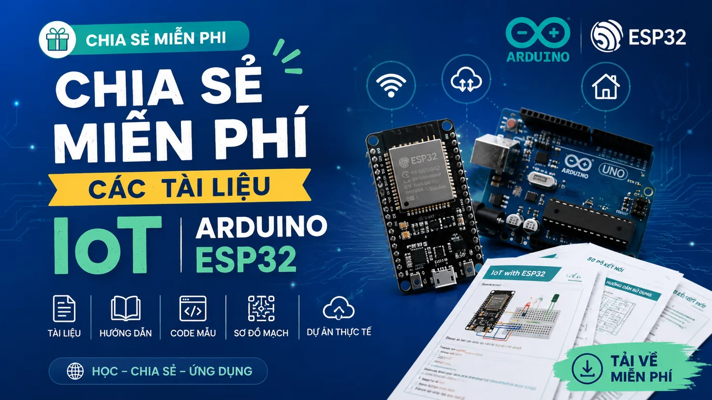

## Danh sách tài liệu

| STT | Tên tài liệu | Từ khóa | Liên kết |
| --- | --- | --- | --- |
| 1 | Ứng dụng Lora trong hệ thống tự động hóa | Lora, IoT | [Tải xuống](https://drive.google.com/file/d/1kd6MP6fUdRShyHbDoSka_HdpMZFeJE-M/view?usp=sharing) |
| 2 | Giáo trình cấu kiện điện tử | Linh kiện | [Tải xuống](https://drive.google.com/file/d/1WYgA9uZOtrmHHM0K2hEpYwNGbFdp38h9/view?usp=sharing) |
| 3 | IoT cho người mới bắt đầu | IoT | [Tải xuống](https://drive.google.com/file/d/1rbvaipIUBwJOlvpSOWG4pasylJGhCjik/view?usp=sharing) |
| 4 | Hướng dẫn sử dụng Arduino cơ bản | Arduino | [Tải xuống](https://drive.google.com/file/d/1a317emeXcqQaR3jjpcG-lyOLuHYZuS5T/view?usp=sharing) |
| 5 | Hệ thống đo mưa và cảnh báo trượt đất | IoT | [Tải xuống](https://drive.google.com/file/d/1iR3sbIwhLajzgspqL_Bw2_GpX0Xs8XFv/view?usp=sharing) |
