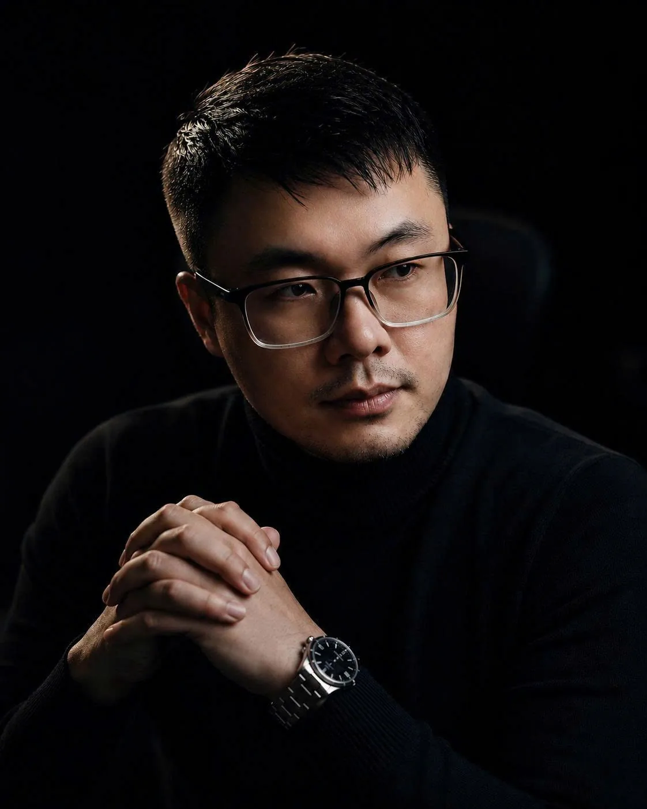

## Education

Master's degree in Information Technology in South Korea; doctoral researcher in Germany.

## Experience

8 years developing and implementing IoT, AI and digital transformation solutions for businesses in Vietnam and abroad.

## Applied AI

- Design and implement AI workflows to automate processes such as data search, content writing, and image/video creation.
- Deploy AI agent systems for individual and business use cases.

## Training & Teaching

Information Technology lecturer at CMCU; delivers AI training for businesses and working professionals at Honda Vietnam and MindX.
