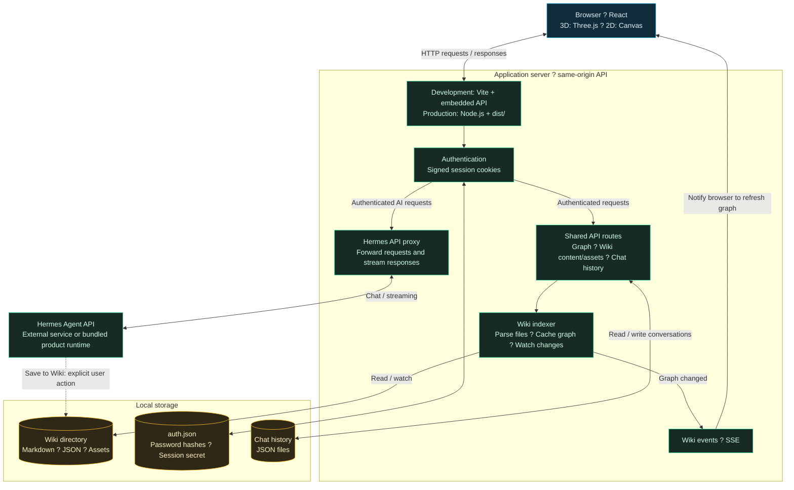

# Second Brain — LLM-Wiki Knowledge Graph

Interactive 3D/2D knowledge graph for exploring an LLM-powered wiki knowledge base.

## Features

- **Knowledge graph visualization** — force-directed layout where nodes represent wiki concepts and edges represent relationships (wikilinks, markdown links, explicit relations)
- **3D & 2D modes** — switch between Three.js/WebGL 3D view and canvas 2D view at runtime
- **AI-powered chat** — ask questions about any node; responses are streamed from the Hermes Agent backend with full node context
- **Real-time sync** — Server-Sent Events push graph updates when wiki files change, no page refresh needed
- **Node detail panel** — view summary, source markdown, media attachments, and navigate to neighbor nodes
- **Category filter & keyword search** — quickly narrow the graph to relevant concepts
- **Chat history per node** — conversations are persisted locally and can be saved back to the wiki as insight documents
- **Dark/light theme** — sci-fi aesthetic with full responsive design (desktop + mobile)

## Architecture



The entire frontend is a single-file React app (~2100 lines) with no external router or state management library. The backend is a lightweight Node.js HTTP server using only built-in modules (no Express). The production server serves static files, proxies to Hermes, and watches the wiki directory for changes.

## Choosing a Wiki Folder

After signing in, open **User menu → Choose Wiki Folder**. Browse the server computer's drives and folders, or enter a path directly, then click **Use this folder**. The graph reloads immediately and watches the selected folder for changes.

The selected path is saved in `data/wiki-settings.json` under the application state directory and reused after a restart. This setting is shared by users of this server. `HERMES_WIKI_DIR` remains the initial fallback when no saved folder is available. In Docker, select a container path such as `/wiki`; host folders must be mounted into the container first. Selecting a folder does not copy or modify its wiki files, or reconfigure the Hermes Agent's own storage.

## Quick Start

### Option 1: Development Environment

Requires **Node.js 22.12+ (or 20.19+)** and a running **Hermes Agent** instance.

```bash
# 1. Install dependencies
npm install

# 2. Configure environment (optional, auto-detection works in most cases)
cp .env.example .env
# Edit .env — set HERMES_WIKI_DIR if your wiki is not at the default location

# 3. Start dev server with hot reload + embedded API
npm run dev

# 4. Open http://localhost:5173
```

The dev server runs Vite with an embedded HTTP API plugin — no separate backend process is needed. All API routes (`/api/graph`, `/api/chat/*`, `/api/wiki/*`, `/api/hermes/*`) are served from the same Vite process.

### Option 2: Docker (Recommended for Production)

Requires **Docker Engine** and **Docker Compose**. No Node.js or nginx setup on the host.

```bash
# 1. Copy and configure environment
cp docker.env.example .env
# Edit .env — at minimum set HERMES_WIKI_DIR and API_SERVER_KEY

# 2. Build and start
docker compose up -d --build

# 3. Open http://localhost:3030 (or the port set in .env)
```

**Updating:**

```bash
git pull && docker compose up -d --build
```

Data (`auth.json`, chat history) is stored in a named Docker volume and persists across container rebuilds.

### Option 3: Nginx + Node.js (Traditional Production)

Requires **Node.js 22.12+ (or 20.19+)**, **npm**, and **nginx** on the target host. See [DEPLOYMENT.md](DEPLOYMENT.md) for the full guide.

```bash
# 1. Install dependencies and build frontend
npm install
npm run build

# 2. Deploy (copies files, writes nginx config, starts the server)
bash scripts/deploy-host.sh
```

The script:
- Copies `dist/` and `server/` to the app directory
- Writes and reloads the nginx configuration
- Starts the Node.js API on `127.0.0.1:3030`
- The Node server serves static files as a fallback; nginx serves them in production for better performance

### Option 4: Standalone Node Server

For quick testing or environments without nginx:

```bash
npm install
npm run build
SECOND_BRAIN_HOST=0.0.0.0 npm run serve
```

The server serves both the static frontend and all API routes from a single process on port 3030.

### Option 5: Product Mode / Bundled Runtime

Product mode is the foundation for a standalone offline installer that bundles Hermes and a private `llm-wiki` directory. It does not read or auto-detect the user's existing `~/.hermes` setup.

```bash
npm run build
npm run serve:product
```

See [PRODUCT_MODE.md](PRODUCT_MODE.md) for the bundled runtime layout and installer contract.

To create the Windows offline product package after adding local release-only Node and Hermes runtime files under the gitignored `runtime/` directory:

```bash
npm run package:windows-product
```

Upload the generated package from `release/` as a GitHub Release artifact; do not commit bundled runtime binaries to the source repository.

## Install and Deploy with PM2 (Linux / VPS)

PM2 keeps the production Node server running and restarts it after a crash. The server serves both `dist/` and `/api/` from one process.

### 1. Install and configure

Install **Node.js 22.12+ (or 20.19+)**, npm, and Git on the host. These Node versions are required by Vite 8. Copy or clone this repository to a permanent application directory, then run the following commands from its root as the user who will run the app:

```bash
node --version
npm --version
npm install -g pm2
npm ci
cp .env.example .env
```

Only copy `.env.example` on the first installation; preserve your existing `.env` during updates. Edit `.env` with values for your host:

```dotenv
HERMES_WIKI_DIR=/home/your-user/wiki
HERMES_API_TARGET=http://127.0.0.1:8643
API_SERVER_KEY=replace-with-your-hermes-api-key
SECOND_BRAIN_HOST=0.0.0.0
SECOND_BRAIN_PORT=3030
SECOND_BRAIN_ADMIN_USER=admin
SECOND_BRAIN_ADMIN_PASSWORD=replace-with-a-strong-password
```

Use an existing wiki path readable by the application user. Hermes must be running separately for AI chat, and `API_SERVER_KEY` must match its configuration. The Node server reads `.env` automatically; no shell `source` command is needed. The admin password initializes credentials on first startup; change an existing account's password through the app user menu.

### 2. Build and start

```bash
npm run build
pm2 start server/second-brain-server.mjs --name second-brain --cwd "$PWD" --time
pm2 status
pm2 logs second-brain --lines 50
```

Press `Ctrl+C` to leave the log viewer; the app keeps running. PM2 runs a single Node process by default. Use this production server rather than `npm run dev` or `npm run preview`.

Verify from the host in another terminal:

```bash
curl -i http://127.0.0.1:3030/
curl -i http://127.0.0.1:3030/api/graph
```

The homepage should return `200`; `/api/graph` should return `401` until you sign in. If no initial admin password was configured, retrieve the generated password from the PM2 logs.

### 3. Restore after reboot

Run these commands as the same application user:

```bash
pm2 startup
# Execute the sudo command printed by PM2 to install the startup service.
pm2 save
```

`pm2 startup` prints the host-specific command; run that command before saving the process list. If Node is later upgraded or its installation path changes, regenerate the startup service following the [PM2 startup guide](https://pm2.keymetrics.io/docs/usage/startup/).

### 4. Access the web app

With `SECOND_BRAIN_HOST=0.0.0.0`, the server accepts connections on all IPv4 interfaces. Open `http://<server-ip>:3030` in your browser and sign in with the configured admin account. Both the frontend and API are served directly by the Node process managed by PM2.

Allow inbound TCP traffic on port `3030` in your VPS provider's firewall/security group. On Ubuntu/Debian hosts where UFW is already enabled, allow the port with:

```bash
sudo ufw allow 3030/tcp
```

If you choose a different `SECOND_BRAIN_PORT`, use that port in the URL, firewall rule, and verification commands. You can also point a domain's DNS to the host and access `http://<your-domain>:3030`.

Use PM2 as the process manager for this setup. The separate `scripts/deploy-host.sh` flow starts its own Node process; do not run it alongside PM2 on the same port.

### 5. Update and manage

From the same repository directory:

```bash
git pull
npm ci
npm run build
pm2 restart second-brain --update-env
pm2 save
```

Restarting reloads `.env`; `--update-env` also refreshes environment variables inherited from the shell. Shell/PM2 environment variables override `.env` values. A single-process restart briefly interrupts active requests and chat streams. Preserve `.env` and `data/` (credentials, wiki selection, and chat history) across deployments.

```bash
pm2 status                              # Process status
pm2 logs second-brain --lines 100        # Recent logs and live output
pm2 monit                               # CPU and memory usage
pm2 restart second-brain --update-env    # Restart after configuration changes
pm2 stop second-brain                    # Stop the app
pm2 delete second-brain                  # Remove the app from PM2
pm2 save                                # Persist the current process list
```

See the [official PM2 documentation](https://pm2.keymetrics.io/docs/usage/quick-start/) for additional process management options.

## Environment Variables

| Variable | Default | Description |
|---|---|---|
| `HERMES_WIKI_DIR` | `~/.hermes/llm-wiki` | Wiki directory (Markdown/JSON files) |
| `HERMES_API_TARGET` | auto-detect | Hermes API base URL |
| `API_SERVER_KEY` | — | Hermes API auth key (Bearer token) |
| `SECOND_BRAIN_PORT` | `3030` | Production server listen port |
| `SECOND_BRAIN_HOST` | `127.0.0.1` | Production server listen address |
| `SECOND_BRAIN_ADMIN_USER` | `admin` | Admin username |
| `SECOND_BRAIN_ADMIN_PASSWORD` | auto-generate | Admin password (auto-generated if not set) |
| `SECOND_BRAIN_AUTH_FILE` | `<project>/data/auth.json` | Credentials storage path |

## Data & Security

- The wiki directory is **read-only** — the app only reads wiki files to build the graph and show node content.
- The app writes only to its own `data/` directory: `auth.json` (credentials) and `data/chat-history/` (per-node conversation logs).
- Authentication uses HMAC-SHA256 signed cookies with scrypt password hashing.
- The "Save to Wiki" action is the only flow that can create new wiki files, and it only runs when the user explicitly clicks that button.

## Scripts

| Command | Description |
|---|---|
| `npm run dev` | Start Vite dev server with hot reload |
| `npm run build` | Build frontend for production |
| `npm run preview` | Preview production build locally |
| `npm run serve` | Run standalone Node.js production server |

## License

MIT
